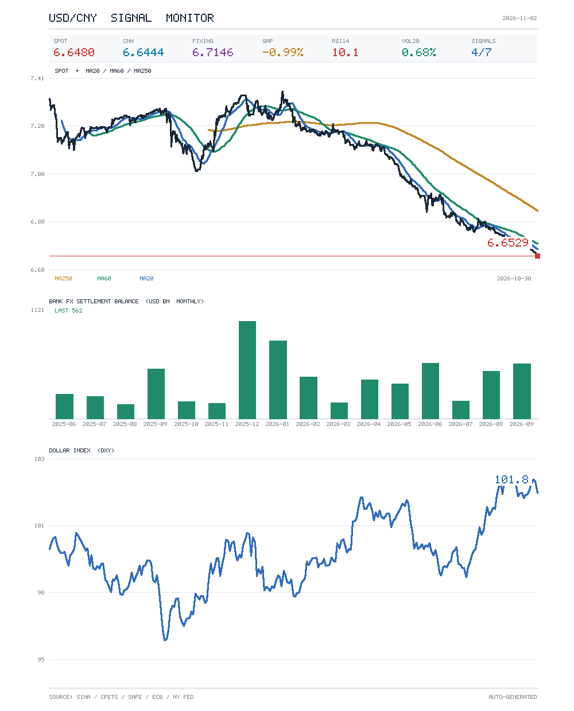

# FX Signal · 人民币汇率底部信号监控

一个跑在 [OpenClaw](https://openclaw.ai) 上的每日汇率监控小项目：取 5 个数据源 → 算 8 项信号 → 生成多信息走势图 → 由大模型写判断与执行建议 → 推送到聊天窗口。

零第三方依赖：画图用自写的 PNG 编码器（zlib + 5×7 点阵字体），不需要 matplotlib / numpy / pandas。



## 它每天做什么

1. 10:05 由 OpenClaw cron 触发一个 agent 任务；
2. 任务调用 `src/fx_daily.py --json --chart --send`：拉数据、算指标、出图、把图发到聊天；
3. 模型读 JSON 快照，写一段日报：现价 / 离岸 / 中间价 / 均线 / 极端度 / 结售汇 / 信号分组 / 建议 / 执行；
4. 正文自动推送到 QQ 或任意已接入的频道。

## 数据源

| 数据 | 来源 | 频率 |
|---|---|---|
| 在岸 USD/CNY 实时 | 新浪财经 `hq.sinajs.cn` | 秒级 |
| 离岸 USD/CNH 实时 | 新浪财经 | 秒级 |
| 官方中间价 | CFETS `chinamoney` | 每日 9:15 |
| 银行结售汇差额 | 国家外汇管理局 xlsx | 每月中下旬 |
| 汇率历史 / 美元指数 | Frankfurter（ECB 参考价） | 每日 16:00 CET |
| SOFR | 纽约联储 API | 每日 |

## 8 项信号（分三组）

**政策面**

| 信号 | 含义 | 判定 |
|---|---|---|
| 中间价压制升值 | 官方中间价明显高于市场价，说明央行在放慢升值 | 偏离 < -0.15% |
| 中间价转调贬 | 中间价连续上调（人民币被引导走弱）= 政策转向 | 连续 ≥ 5 个交易日 |

**资金面**

| 信号 | 含义 | 判定 |
|---|---|---|
| 离岸转弱 | 离岸 CNH 由强转弱先于在岸，通常领先 1–2 周 | CNH 高于 CNY > 5 点 |
| 结汇盘衰竭 | 出口企业结汇是这轮升值的主推力，顺差收窄意味着推力衰减 | 顺差连续 2 个月收窄 |

**价格面**

| 信号 | 含义 | 判定 |
|---|---|---|
| 跌幅近历史下沿 | 历史单轮升值幅度 -8% ~ -12% | 本轮 ≤ -8.5% |
| 波动率压缩 | 单边行情末期的典型特征（方向未定，只提示将破位） | 20 日年化 < 1% |
| RSI 超卖 | 短期动能耗尽 | RSI14 < 25 |
| 站上 MA250 | 中期趋势反转确认（唯一的事后确认信号） | 收盘 > MA250 |

打分：**≥6 转多（可满配）｜4–5 分批加仓｜≤3 观望**。分数只是给模型的输入，最终建议由模型结合上下文判断，不是硬编码。

口径细节见 [docs/signals.md](docs/signals.md)。

## 部署

详见 [docs/deploy.md](docs/deploy.md)。最短路径：

```bash
git clone <this-repo> && cd fx-signal
cp config/settings.example.json config/settings.json   # 填聊天目标 ID
bash scripts/install.sh                                # 部署到 OpenClaw 工作区
```

然后在 OpenClaw 里注册定时任务与聊天命令（`scripts/ops.sh` 里有现成命令）。

## 聊天命令

在支持的聊天窗口里直接输入：

| 命令 | 作用 |
|---|---|
| `/fx` | 立刻跑一次汇率日报（含图） |
| `/help` | 列出本 bot 的全部自定义命令 |

命令由工作区 `AGENTS.md` 里的 standing orders 定义，改 `AGENTS.md` 即可增删。

## 目录

```
fx-signal/
├── src/                 主程序、画布、图表布局
├── config/              提示词与运行时配置
├── docs/                信号口径、部署手册
├── scripts/             安装与运维脚本
├── samples/             示例图
└── data/                运行时数据（不入库）
```

## 模型：试过，但没上线

我用 2010–2026 的数据训练过 3 状态 HMM + 状态内逻辑回归、以及多种逻辑回归变体，用 purged walk-forward（5 折、embargo 60 天）验证：

| 方法 | 平均 AUC |
|---|---|
| 现有规则打分 | 0.508（标签A）/ 0.574（标签B） |
| 单特征回撤 | 0.557 |
| LR 3 特征 | 0.557 |
| HMM + 状态内 LR | **0.399** |

**没有一个稳定超过 0.60，HMM 版本甚至比随机还差。** 原因是有效独立样本只有约 59 个（3550 天 ÷ 60 天重叠窗口），且标签基率逐段漂移。

所以本项目**不部署机器学习模型**，改用「规则分 → 历史经验频率」的查表方式（无参数、不过拟合）：

| 规则分 | 样本 | P(60日涨>0) |
|---|---|---|
| 0 | 1279 | 24.3% |
| 1 | 2536 | 49.1% |
| 2 | 186 | 58.1% |

完整数字与复现脚本见 [model/BACKTEST.md](model/BACKTEST.md) 与 `model/`。

## 许可

AGPL-3.0。可以自由使用、修改、分发，但**必须保留原作者署名，且衍生作品不得闭源**（包括以网络服务形式提供）。